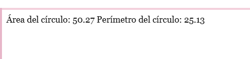
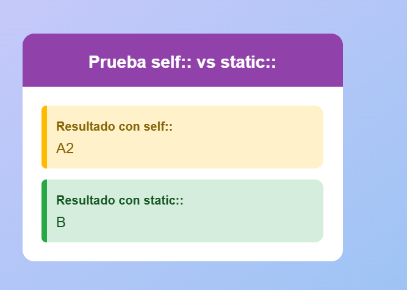
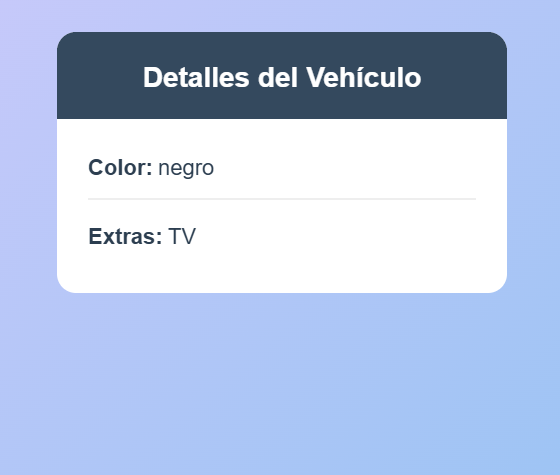
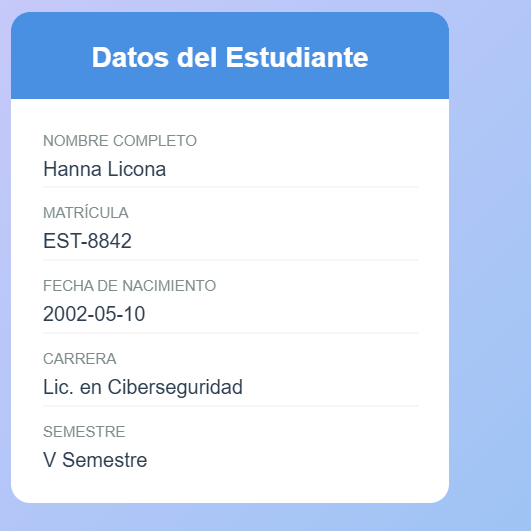

# Universidad Tecnológica de Panamá
## Facultad de Ingeniería de Sistemas Computacionales
### Licenciatura en Ciberseguridad

**Práctica:** Práctica sobre herencia  
**Estudiante:** Hanna Licona  
**Cédula:** 8-1050-1065  
**Grupo:** 1S3122  
**Asignatura:** Desarrollo Web  
**Profesor:** Irina Fong  
**Fecha:** 2 de octubre de 2026

---

## Recursos

- Computador.
- Internet.
- Guía de la investigación.
- Biblioteca Virtual.
- Bibliografía del curso.
- Plataforma virtual UTP.

---

## Tecnologías utilizadas

- **PHP:** Para definir clases y objetos, aplicar herencia y encapsulamiento, y calcular el área y el perímetro de un círculo.
- **HTML5 y CSS3:** Para mostrar los resultados de los ejemplos en el navegador.
- **Visual Studio Code:** Entorno utilizado para escribir y editar el código.
- **WAMP:** Servidor local utilizado para ejecutar PHP con Apache.

---

## Información relevante

Este proyecto presenta conceptos fundamentales de la **Programación Orientada a Objetos (POO)** en PHP:

- **Herencia:** `Estudiante` y `DocenteResumen` reutilizan propiedades y métodos de `Persona`; `CocheDeLujo` hereda de `Coche`.
- **Encapsulamiento:** Las propiedades protegidas y privadas controlan el acceso a los datos de los objetos.
- **Restricción de herencia (`final`):** `Impedirherencia.php` muestra que una clase declarada `final` no se puede extender. El archivo intenta heredar de esa clase y, por eso, al ejecutarlo se produce intencionalmente un error fatal.
- **Enlace estático tardío (`self::` vs. `static::`):** El ejemplo compara cómo se resuelve una llamada estática en la clase base y en la clase derivada.

---

## Visualización

Inicia un servidor PHP desde la carpeta del proyecto:

```bash
php -S localhost:8000
```

Abre cualquiera de estas páginas en el navegador para ver los ejercicios:

- [Datos del estudiante](http://localhost:8000/estudiante.php)
- [Datos del docente](http://localhost:8000/docente.php)
- [Detalles del vehículo](http://localhost:8000/coche.php)
- [Prueba de `self::` vs. `static::`](http://localhost:8000/EjemploLateStatic.php)
- [Área y perímetro del círculo](http://localhost:8000/circulo.php)

### Área y perímetro del círculo



### Prueba de `self::` vs. `static::`



### Detalles del vehículo



### Datos del estudiante


